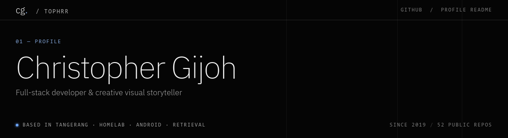

 

 

 

## / profile

Full-stack in the pragmatic sense: I write the app, the API and the box it runs on. Android in
Kotlin and Compose, retrieval and data work in Python, web in TypeScript, ESP32 when a problem is
physical. Most of it ends up offline-first or self-hosted, and small enough to explain in one
paragraph.

## / projects

- **[tjxplore](https://github.com/tophrr/tjxplore)** — transit and POI recommender: the whole TransJakarta schedule plus OpenStreetMap places within 10 km of Blok M, semantic search joined to an open-source routing engine, so you can ask for a trip or a place in plain language. `Python` `PostGIS` `Qdrant` `MOTIS` `FastAPI`
- **[mindurset](https://github.com/tophrr/mindurset)** — Android mental-health app with a serverless backend. I ran a four-person team and wrote the Cloudflare Workers side: vector retrieval, RAG and an LLM API for context-aware replies, keys kept server-side, tests in CI. `Kotlin` `Compose` `Workers` `GitHub Actions`
- **[aap-edge](https://github.com/tophrr/aap-edge)** — ESP32 node for a pedestrian crossing: Goertzel DSP over a 16 kHz I2S microphone recognises the buzzer's signature on the board itself, so no audio ever leaves it; start and end events go out over MQTT, with remote config and OTA. Its live tuner is **[aap-dashboard](https://github.com/tophrr/aap-dashboard)**. `C++` `ESP32` `MQTT`
- **Homelab** — a Proxmox host, a NAS VM running 55 containers, an external VPS with 27 containerized services and a MikroTik router, behind Caddy and Cloudflare Tunnel. Built and maintained since 2019. `Docker Compose` `Caddy` `WireGuard`

## / now

- Running the lab that hosts my own services, backups included
- Reading retrieval papers and turning the good parts into small working demos
- Teaching a microcontroller to listen better than I do

 

 

| BASED IN | FOCUS | NOW | ELSEWHERE |
| :--- | :--- | :--- | :--- |
| Tangerang, Indonesia | Full-stack · infrastructure · applied ML | Homelab and Mind-Ur-Set | [chrisg.my.id](https://chrisg.my.id) · [LinkedIn](https://www.linkedin.com/in/christophergijoh) · chris@chrisg.my.id |

