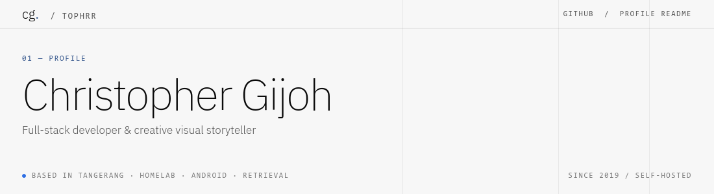

<picture>
  <source media="(prefers-color-scheme: dark)" srcset="https://raw.githubusercontent.com/tophrr/tophrr/main/assets/banner.png" />
  
</picture>

<picture>
  <source media="(prefers-color-scheme: dark)" srcset="https://readme-typing-svg.demolab.com?font=IBM+Plex+Mono&weight=400&size=18&duration=3600&pause=1200&color=7FA0D1&center=true&vCenter=true&width=560&lines=%2F+full-stack+developer;%2F+homelab+operator;%2F+android+%C2%B7+retrieval+%C2%B7+esp32" />
  
</picture>

 

 

<picture>
  <source media="(prefers-color-scheme: dark)" srcset="https://github-readme-stats.vercel.app/api?username=tophrr&show_icons=true&hide_border=false&border_color=252525&bg_color=0A0A0A&title_color=F5F5F5&icon_color=7FA0D1&ring_color=3F5F92&text_color=8C8C8C" />
  
</picture>
<picture>
  <source media="(prefers-color-scheme: dark)" srcset="https://github-readme-stats.vercel.app/api/top-langs/?username=tophrr&layout=compact&langs_count=6&hide_border=false&border_color=252525&bg_color=0A0A0A&title_color=F5F5F5&text_color=8C8C8C&hide=css%2Chtml%2Cplpgsql%2Cjupyter%20notebook%2Ctex%2Cphp%2Cdockerfile%2Cshell" />
  
</picture>

<picture>
  <source media="(prefers-color-scheme: dark)" srcset="https://streak-stats.demolab.com?user=tophrr&hide_border=false&border=252525&background=0A0A0A&stroke=252525&ring=7FA0D1&fire=6EA8FE&currStreakNum=F5F5F5&currStreakLabel=7FA0D1&sideNums=F5F5F5&sideLabels=8C8C8C&dates=6F6F6F" />
  
</picture>

 

## / profile

An undergraduate studying informatics, exploring computing across stacks: microcontrollers and
self-hosted infrastructure on one side, web services and interface design on the other. Curiosity
gets me started, constraints keep me engaged, and most of what lands here ends up offline-first,
self-hosted, or small enough to hold in one hand.

I like software that lasts, systems I can explain in one paragraph, and the occasional color grade.

## / projects

- **[tjxplore](https://github.com/tophrr/tjxplore)** — transit and POI recommender: the whole TransJakarta schedule plus OpenStreetMap places within 10 km of Blok M, semantic search joined to an open-source routing engine, so you can ask for a trip or a place in plain language. `Python` `PostGIS` `Qdrant` `MOTIS` `FastAPI`
- **[mindurset](https://github.com/tophrr/mindurset)** — Android mental-health app with a serverless backend. I ran a four-person team and wrote the Cloudflare Workers side: vector retrieval, RAG and an LLM API for context-aware replies, keys kept server-side, tests in CI. `Kotlin` `Compose` `Workers` `GitHub Actions`
- **[aap-edge](https://github.com/tophrr/aap-edge)** — ESP32 node for a pedestrian crossing: Goertzel DSP over a 16 kHz I2S microphone recognises the buzzer's signature on the board itself, so no audio ever leaves it; start and end events go out over MQTT, with remote config and OTA. Its live tuner is **[aap-dashboard](https://github.com/tophrr/aap-dashboard)**. `C++` `ESP32` `MQTT`
- **Homelab** — a Proxmox host, a NAS VM running 55 containers, an external VPS with 27 containerized services and a MikroTik router, behind Caddy and Cloudflare Tunnel. Built and maintained since 2019. `Docker Compose` `Caddy` `WireGuard`

## / now

- Keeping the lab alive: Proxmox, backups, and one very patient MikroTik
- Reading retrieval papers and rebuilding the interesting parts as small demos
- Dialing in a color grade when the code stops being the hard part

 

<picture>
  <source media="(prefers-color-scheme: dark)" srcset="https://raw.githubusercontent.com/tophrr/tophrr/output/github-snake-dark.svg" />
  
</picture>

 

| BASED IN | FOCUS | NOW | ELSEWHERE |
| :--- | :--- | :--- | :--- |
| Tangerang, Indonesia | Full-stack · infrastructure · applied ML | Homelab and Mind-Ur-Set | [chrisg.my.id](https://chrisg.my.id) · [LinkedIn](https://www.linkedin.com/in/christophergijoh) · hello@chrisg.my.id |

